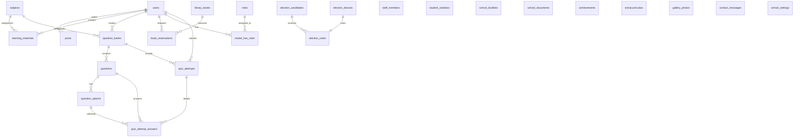

# Software Architecture Document (SAD)
## SMP Negeri 4 Cepu: "Satu Sekolah, Satu Ruang Digital"

---

## 1. Ikhtisar Arsitektur Sistem

Arsitektur aplikasi dibangun dengan paradigma **Modular Monolith** memanfaatkan ekosistem **TALL Stack (Tailwind CSS, Alpine.js, Laravel 11/12, Livewire v3)** dan **Filament PHP** dengan arsitektur modern. Pendekatan ini dipilih berdasarkan evaluasi mendalam atas kebutuhan stabilitas jangka panjang, efisiensi pemeliharaan oleh tim internal sekolah, dan lingkungan hosting terkelola **Hostinger Cloud Startup** (LiteSpeed Web Server Enterprise, PHP 8.3+, MariaDB 10.11+, 4 vCPU, 4GB RAM, tanpa daemon proses root/WebSocket persisten).

```text
+-----------------------------------------------------------------------------------+
|                                  CLIENT LAYER                                     |
|   Desktop Browser / Mobile Phone / Tablet (Light & Dark Mode: Alpine.js + CSS)    |
+-----------------------------------------+-----------------------------------------+
                                          | HTTPS (TLS 1.3)
                                          v
+-----------------------------------------------------------------------------------+
|                         WEB SERVER LAYER (HOSTINGER CLOUD)                        |
|   LiteSpeed Web Server Enterprise (LSWS)                                          |
|   - Event-Driven Architecture (100 Concurrent PHP Workers)                        |
|   - LiteSpeed Cache (LSCache) & Static Asset Compression (Gzip/Brotli)            |
|   - .htaccess Rules (Cache Bypass for /admin, /livewire, & 301 Apex Redirect)     |
+-----------------------------------------+-----------------------------------------+
                                          | LSPHP 8.3 (LiteSpeed SAPI) + Zend OPcache
                                          v
+-----------------------------------------------------------------------------------+
|                        APPLICATION LAYER (LARAVEL 11/12)                          |
|                                                                                   |
|  [ Presentation Domain ]                                                          |
|  ├── Blade Views + Tailwind v3 : Portal Profil Publik, Informasi, Berita, Galeri |
|  ├── Livewire v3 Components    : Filter GTK, Bilik Pilketos, Quick Count Polling  |
|  └── Filament Admin (20 Modul) : Back-Office CMS, CBT Rekap, 609 Siswa, RBAC      |
|                                                                                   |
|  [ Security & Authorization ]                                                     |
|  ├── Filament Shield           : RBAC (super_admin, guru, staf_perpus, pilketos,  |
|  │                               siswa)                                           |
|  └── Session & Cookie Auth     : Database Session Driver + HttpOnly Strict Cookie |
|                                                                                   |
|  [ Core Business Services ]                                                       |
|  ├── PilketosFingerprintService: Multi-layer Device Identity, Subnet /24, Voting   |
|  ├── QuizAssessmentService     : Zero Client Leakage, Server Evaluation, Scoring |
|  ├── Seo Support Engine        : Dynamic OpenGraph, Twitter, Schema.org JSON-LD   |
|  └── SmartGlobalSearchProvider : Quick Jump (Ctrl+K) Lintas 8 Entitas Data        |
|                                                                                   |
|  [ Domain Model Layer (Eloquent ORM) ]                                            |
|  ├── User (609 Siswa + Staf), Post, StaffMember, StudentStatistic, Facility       |
|  ├── LibraryBook, BookReservation, Subject, LearningMaterial, QuestionBank       |
|  └── QuizAttempt, QuizAttemptAnswer, ElectionCandidate, ElectionVote, Device     |
+-----------------------------------------+-----------------------------------------+
                                          | PDO MySQL Connection
                                          v
+-----------------------------------------------------------------------------------+
|                         DATABASE LAYER (MARIADB 10.11+)                           |
|   - 20+ Relational Tables Normalized to 3NF                                       |
|   - Strict Foreign Key Cascades & Composite B-Tree Indexes                        |
|   - Isolated Anonymous Ballot Box & Device Audit Tables                           |
+-----------------------------------------------------------------------------------+
```

---

## 2. Struktur Modul & Penataan Direktori

Sistem mengadopsi struktur monolitik modular untuk memisahkan domain logika bisnis tanpa fragmentasi repositori:

```text
laravel_app/
├── app/
│   ├── Enums/                              # Strict Types & Value Objects PHP 8.3+
│   │   ├── EmploymentStatus.php            # PNS, PPPK, Honorer
│   │   ├── GradeLevel.php                  # Kelas 7, 8, 9
│   │   └── PostCategory.php                # Berita, Pengumuman, Agenda
│   ├── Filament/                           # Panel Admin & Back-Office Terpadu
│   │   ├── GlobalSearch/
│   │   │   └── SmartGlobalSearchProvider.php # Pencarian Global Cepat (Ctrl+K)
│   │   ├── Pages/                          # Dashboard & Profil Custom
│   │   ├── Resources/                      # 20 Modul CRUD Lengkap
│   │   │   ├── Achievements/               # Prestasi Siswa
│   │   │   ├── BookReservations/           # Permohonan Pinjam Buku Siswa
│   │   │   ├── ContactMessages/            # Kotak Pesan Masuk & Aduan Publik
│   │   │   ├── ElectionCandidates/         # Manajemen Paslon Pilketos
│   │   │   ├── ElectionVotes/              # Kotak Suara & Log Voting Pilketos
│   │   │   ├── Extracurriculars/           # Kegiatan Ekstrakurikuler
│   │   │   ├── GalleryPhotos/              # Galeri Foto Dokumentasi Kegiatan
│   │   │   ├── LearningMaterials/          # Modul Bahan Ajar per Mapel/Kelas
│   │   │   ├── LibraryBooks/               # Katalog Buku & Nomor Rak Perpus
│   │   │   ├── Posts/                      # Warta Sekolah: Berita, Pengumuman, Agenda
│   │   │   ├── QuestionBanks/              # Bank Soal CBT & Token Pengerjaan
│   │   │   ├── QuizAttempts/               # Rekap Nilai & Lembar Jawaban Kuis Siswa
│   │   │   ├── SchoolDocuments/            # Pusat Unduhan Berkas Resmi
│   │   │   ├── SchoolFacilities/           # Sarana & Prasarana Sekolah
│   │   │   ├── SchoolSettings/             # Pengaturan Profil, Visi, Misi, Sambutan
│   │   │   ├── StaffMembers/               # Direktori 33 Tenaga Pendidik & Kependidikan
│   │   │   ├── Students/                   # Data 609 Siswa Aktif (Rombel 7A-9F)
│   │   │   ├── StudentStatistics/          # Rekap Statistik Rombel & Auto-Sync
│   │   │   ├── Subjects/                   # Master 11 Mata Pelajaran Resmi SMP
│   │   │   └── Users/                      # Manajemen Akun: Tabs Staf vs Siswa
│   │   └── Widgets/
│   │       ├── PilketosLiveChartWidget.php # Realtime Chart Polling (wire:poll.5s)
│   │       └── SchoolOverviewWidget.php    # Ringkasan Metrik Sekolah
│   ├── Http/
│   │   └── Controllers/
│   │       └── SeoController.php           # Dynamic sitemap.xml, robots.txt, feed.xml
│   ├── Livewire/                           # Komponen Interaktif Frontend Publik
│   │   ├── Pilketos/
│   │   │   ├── LiveCount.php               # Polling Grafik Quick Count Terbuka
│   │   │   └── VotingBooth.php             # Bilik Suara Digital
│   │   └── Quiz/
│   │       └── QuizRoom.php                # Ruang Latihan Soal Interaktif
│   ├── Models/                             # 18 Model Eloquent Lengkap Relasi
│   ├── Policies/                           # Otorisasi Kebijakan Filament Shield
│   ├── Services/                           # Core Business Services
│   │   ├── PilketosFingerprintService.php  # Validasi Keamanan Multi-Tier Pilketos
│   │   └── QuizAssessmentService.php       # Zero-Leakage & Penilaian Bank Soal
│   └── Support/
│       └── Seo.php                         # Generator Metadata & Schema.org JSON-LD
├── database/
│   ├── migrations/                         # 14+ Migrasi Inti 3NF + Spatie Tables
│   └── seeders/                            # Seeder 609 Siswa, 33 GTK, Mapel, & Pengaturan
├── public/                                 # Symlinked ke public_html
│   ├── build/                              # Aset Vite Terkompilasi (CSS & JS)
│   └── .htaccess                           # Aturan Routing, Apex 301, & Bypass LSCache
└── tests/
    └── Feature/
        ├── AdminPanelTest.php              # Pengujian Hak Akses Dashboard Filament
        ├── CoreServicesTest.php            # Pengujian Layanan Inti & Otorisasi RBAC
        ├── LibraryReservationTest.php      # Pengujian Alur Reservasi Buku
        ├── StudentManagementTest.php       # Pengujian CRUD Siswa & Sinkronisasi
        └── PublicSeoTest.php               # Pengujian Sitemap, Robots, & Schema.org
```

---

## 3. Skema Basis Data Relasional (3NF & Relational Integrity)

### 3.1 Diagram Relasi Entitas (ERD)



### 3.2 Kamus Entitas Relasional

1. **`users`**: Entitas akun terpadu mencakup staf sekolah dan **609 siswa aktif**. Kolom kredensial: `name`, `email`, `password`. Kolom khusus staf: `nip`, `dapodik_id`. Kolom khusus peserta didik: `nisn` (indexed, unique), `nis`, `gender` (L/P), `birth_place`, `birth_date`, `student_class` (7A s.d. 9F).
2. **`roles` & `permissions`**: Skema Spatie Permission untuk kontrol otorisasi RBAC granular (`super_admin`, `guru`, `staf_perpus`, `panitia_pilketos`, `siswa`).
3. **`posts`**: Publikasi warta sekolah dengan kategori ENUM (`berita`, `pengumuman`, `agenda`), `slug` unik terindeks, `event_date`, dan soft deletes.
4. **`staff_members`**: Direktori Pendidik dan Tenaga Kependidikan dengan indeks komposit `(position, employment_status)` untuk mendukung filter cepat Livewire.
5. **`student_statistics`**: Agregasi jumlah siswa per rombel per tahun ajaran dengan batasan unik komposit `['academic_year', 'class_name']`. Terhubung dengan fitur auto-sync data dari tabel `users`.
6. **`school_facilities`**: Direktori fasilitas fisik sekolah dengan atribut `display_order` dan gambar representatif.
7. **`library_books`**: Katalog sirkulasi perpustakaan dengan indeks pencarian pada `title`, `author`, `category`, nomor rak, serta integritas `available_stock`.
8. **`book_reservations`**: Rekam permohonan peminjaman buku oleh siswa berstatus `pending`, `approved`, `returned`, atau `rejected`.
9. **`subjects`**: Master 11 mata pelajaran Kurikulum Merdeka tingkat SMP.
10. **`learning_materials`**: Bahan ajar terstruktur per jenjang kelas (7, 8, 9) dan mata pelajaran dengan lampiran berkas atau URL materi.
11. **`question_banks`**: Paket bank soal latihan mandiri dengan token/password soal, durasi waktu pengerjaan, dan ambang batas kelulusan (`passing_grade`).
12. **`questions` & `question_options`**: Butir pertanyaan pilihan ganda dengan opsi jawaban. Berelasi cascading delete terhadap bank soal.
13. **`quiz_attempts` & `quiz_attempt_answers`**: Rekaman sesi latihan mandiri siswa dengan pembobotan nilai otomatis, waktu pengerjaan, dan status kelulusan.
14. **`election_candidates`**: Data pasangan calon ketua/wakil ketua OSIS dengan counter cache `total_votes_cached`.
15. **`election_devices`**: Log sidik jari perangkat pemilih dengan indeks unik `device_fingerprint`.
16. **`election_votes`**: Kotak suara digital yang dipisahkan secara fisik dan anonim dari data voter untuk menjamin asas rahasia pemilu.
17. **`school_documents`**: Pusat repositori berkas publik (kurikulum, kalender akademik, formulir pendaftaran) untuk diunduh warga sekolah.
18. **`achievements` & `extracurriculars`**: Katalog prestasi dan ekstrakurikuler sekolah lengkap dengan dokumentasi foto dan profil pembina.
19. **`gallery_photos`**: Arsip foto kegiatan sekolah dengan keterangan acara dan kategori.
20. **`contact_messages`**: Kotak masuk pengaduan, kritik, dan saran dari formulir kontak publik.
21. **`school_settings`**: Penyimpanan key-value dinamis untuk profil sekolah, sambutan kepala sekolah, visi, misi, dan tautan media sosial.

---

## 4. Rekayasa Keamanan & Layanan Inti (Core Services)

### 4.1 Pilketos Multi-Layer Identity Engine (`PilketosFingerprintService`)

Tantangan utama Pilketos adalah menegakkan prinsip **"1 Suara per Perangkat"** secara terbuka tanpa membebani siswa dengan registrasi akun terpisah saat voting, sekaligus mencegah kecurangan manipulasi peramban (*incognito mode*, pembersihan kuki, multi-tab).

```text
[ Browser Klien ]
  │
  ├── 1. Ekstraksi Entropi Hardware (Canvas, WebGL, AudioContext, Screen Res, OS Platform)
  └── 2. Kirim Payload ke Endpoint HTTPS
            │
            v
[ Server-Side Engine: PilketosFingerprintService ]
  │
  ├── Layer 1: Evaluasi Cookie Kriptografis (HttpOnly + SameSite=Strict)
  │            -> Jika cookie 'pilketos_voter_token' ada: REJECT (Sudah Pernah Memilih).
  │
  ├── Layer 2: Sintesis Sidik Jari Server (Composite Hash SHA-256)
  │            -> Hash = SHA256(CookieToken | ClientHardwareHash | IPSubnet/24 | UserAgentHash)
  │
  ├── Layer 3: Pengecekan Basis Data (election_devices)
  │            -> Jika device_fingerprint cocok di database: REJECT (Perangkat Terindikasi Duplikat).
  │
  ├── Layer 4: Penanganan Jaringan NAT Bersama (/24 Subnet Normalization)
  │            -> Masking IP ke /24 (IPv4) atau /64 (IPv6). Ratusan siswa dalam satu Wi-Fi
  │               sekolah tidak akan saling tolak karena hardware hash mereka unik.
  │
  └── Sukses: Eksekusi Transaksi Atomik (DB::transaction)
              ├── Rekam perangkat ke `election_devices`
              ├── Simpan suara anonim ke `election_votes`
              ├── Increment atomik `total_votes_cached` pada `election_candidates`
              └── Terbitkan cookie HttpOnly permanen (365 hari) ke peramban.
```

### 4.2 Mesin Evaluasi Kuis Tanpa Kebocoran Klien (`QuizAssessmentService`)

Untuk menjamin latihan mandiri berintegritas tinggi, sistem menerapkan prinsip **Zero Client Leakage**:

1. **Proyeksi Kueri Aman**: Saat kuis dimuat, Eloquent hanya memproyeksikan `['id', 'question_id', 'option_text']` dari relasi opsi jawaban. Kolom `is_correct` dan `explanation` dipangkas di server sehingga tidak ada metadata kunci jawaban yang mengalir ke tab Network atau Console peramban siswa.
2. **Server-Side Scoring**: Lembar jawaban dikirim berupa pasangan ID `[question_id => selected_option_id]`. Server melakukan pencocokan langsung terhadap basis data, menghitung skor terbobot berbasis skala 100, menentukan kelulusan berdasarkan `passing_grade`, dan menyimpan rekaman ke `quiz_attempts`.
3. **Pembahasan Reflektif Pasca-Ujian**: Setelah lembar ujian tersimpan, server menyusun respons umpan balik yang memuat skor akhir, butir salah/benar, dan teks pembahasan (`explanation`) sebagai materi evaluasi belajar.

### 4.3 Mesin Optimasi SEO & Metadata Terstruktur (`App\Support\Seo`)

Dirancang untuk menempatkan portal SMP Negeri 4 Cepu pada peringkat tertinggi di mesin pencari Google:
- **Title & Description Builder**: Pembuatan judul dan deskripsi kontekstual untuk setiap jenis halaman (beranda, profil, direktori guru, berita artikel, katalog perpustakaan, latihan soal).
- **Canonical URL & OpenGraph**: Menghilangkan duplikasi URL serta menghasilkan tag OpenGraph dan Twitter Card yang kaya saat tautan dibagikan ke WhatsApp, Facebook, dan media sosial lainnya.
- **Schema.org JSON-LD**: Injeksi terstruktur mikrodata `EducationalOrganization` (memuat nama sekolah, NPSN, koordinat peta, alamat resmi, nomor telepon, surel), `WebSite` (dengan fitur Sitelinks SearchBox), `WebPage`, dan `NewsArticle` untuk artikel berita.
- **Dynamic Sitemap & Feed**: Rute `/sitemap.xml` yang bebas kuki dengan frekuensi pembaruan dinamis dan tag gambar Google, serta `/feed.xml` RSS 2.0 untuk pembaca berita otomatis.

### 4.4 Sistem Pencarian Global Cerdas (`SmartGlobalSearchProvider`)

Panel admin dilengkapi dengan command palette cerdas (`Ctrl + K` atau `Cmd + K`) yang mengindeks 8 entitas data utama secara bersamaan: Berita/Artikel, Tenaga Pendidik & Kependidikan, Data Peserta Didik (Siswa), Buku Perpustakaan, Mata Pelajaran, Materi Belajar, Bank Soal, dan Fasilitas Sekolah. Pencarian dilakukan dengan pembatasan kueri efisien untuk menjaga performa server tetap prima.

---

## 5. Arsitektur Infrastruktur & Deployment Hostinger Cloud

### 5.1 Isolasi Direktori (Security Boundary)

Untuk mencegah berkas lingkungan (`.env`), file migrasi, vendor PHP, dan log terekspos ke publik akibat miskonfigurasi web server, struktur direktori dipisahkan secara fisik:

```text
/home/u652241328/domains/smpn4cepu.sch.id/
├── laravel_app/                     # Direktori Privat (Root Aplikasi Laravel)
│   ├── app/
│   ├── config/
│   ├── database/
│   ├── storage/
│   ├── .env                         # Terisolasi penuh dari web root
│   ├── deploy.sh
│   └── ...
└── public_html/ -> laravel_app/public # Symlink murni ke public folder
```

### 5.2 Strategi Caching & Integrasi LiteSpeed (LSWS)

1. **LiteSpeed Cache Bypass**:
   Pada berkas `public/.htaccess`, rute dinamis panel administrasi (`/admin`), transaksi asinkron Livewire (`/livewire`), dan modul interaktif kuis/voting diberikan direktif `Cache-Control: no-cache` agar interaksi formulir dan polling data real-time tidak terhalang cache statis LiteSpeed.
2. **Framework Optimization**:
   Pada lingkungan produksi, seluruh konfigurasi, rute, view Blade, dan event di-cache menggunakan perintah Artisan:
   - `php artisan config:cache`
   - `php artisan route:cache`
   - `php artisan view:cache`
   - `php artisan event:cache`
3. **Zend OPcache**:
   Memanfaatkan alokasi memori OPcache 384 MB pada Hostinger Cloud Startup untuk mengeksekusi bytecode PHP tanpa kompilasi ulang pada setiap request.
4. **Canonical Apex 301 Redirect**:
   Mengarahkan seluruh permintaan dari sub-domain `www.smpn4cepu.sch.id` secara permanen ke domain kanonikal `https://smpn4cepu.sch.id` demi integritas SEO dan efisiensi cache SSL.

### 5.3 Pipa Otomasi CI/CD (GitHub Actions)

Repositori dikonfigurasi dengan pipeline integrasi berkelanjutan pada berkas `.github/workflows/deploy.yml`:
- **Job 1 (Test & Lint)**: Membangun dependensi Composer, mengompilasi aset Vite produksi, menjalankan migrasi database SQLite in-memory, dan mengeksekusi 24 automated tests (216 assertions) pada PHP 8.3 dan Node.js 20.
- **Job 2 (Deploy to Hostinger)**: Mentransfer build aset segar via SCP dan mengeksekusi skrip `deploy.sh` melalui SSH pada port 65002.
- **Catatan Jaringan SSH**: Hostinger mengalirkan trafik domain web publik melalui proxy/CDN yang membatasi akses port SSH non-standar (port 65002). Oleh karena itu, rahasia `HOSTINGER_HOST` pada GitHub Secrets harus diisi dengan **IP Server Asli** yang tercantum pada menu SSH Access di hPanel Hostinger.
